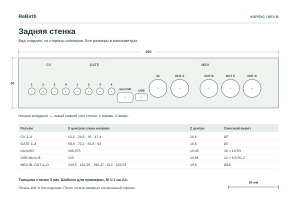
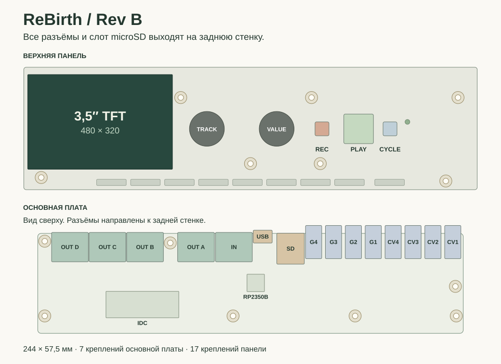

# ReBirth Rev B · RP2354B

Все внешние подключения Rev B находятся на задней стенке. Слева направо при взгляде со стороны штекеров идут **CV 1–4, GATE 1–4, microSD, USB Micro-B, MIDI IN и MIDI OUT A–D**. Габариты плат и крепёж соответствуют Rev A.



**Чертёж для примерки** можно распечатать на A4 при масштабе 100 %. Контрольный отрезок на листе равен 50 мм. DXF содержит наружный контур и 15 сквозных вырезов в миллиметрах. Начало координат находится в левом нижнем углу при взгляде снаружи. STEP содержит стенку в системе координат корпуса. PDF 1:1 собирается из [SVG](rear-panel.svg) командой в конце страницы. [DXF](rear-panel.dxf) · [STEP](rear-panel.step)

## Задняя стенка

Внешние размеры стенки между деревянными боковинами составляют **260 × 50 × 3 мм**. Внутренняя плоскость находится на Y = 132, внешняя на Y = 135. Верх основной платы лежит на высоте 9,6 мм от низа корпуса. Стенка имеет тот же наружный контур, что и в модели лотка Rev A. [Исходная модель корпуса](../panel/build_internals.py)

| Подключение | Принятый сквозной вырез | Посадка |
|---|---|---|
| 4 CV и 4 GATE | 8 × Ø7 мм | Втулка SJ1-3533NG имеет диаметр 6 мм, ось на 7 мм выше платы. Торец втулки выступает из стенки на 0,5 мм. [Чертёж Same Sky, стр. 2](https://www.sameskydevices.com/product/resource/sj1-353xng.pdf#page=2) |
| microSD | 16 × 10 мм, R3 | Окно центрировано по карте. От наружной поверхности край карты в защёлкнутом положении утоплен на 2,6 мм, для срабатывания её нужно нажать ещё на 0,8 мм. После отпускания край выступает на 1,4 мм. [Hirose DM3AT, чертёж](https://www.hirose.com/product/download/?distributor=chip1&lang=en&num=DM3AT-SF-PEJM5&type=2d) |
| USB Micro-B | 12 × 6,5 мм, R1,2 | Торец гнезда утоплен на 2,2 мм. Положение J301 сдвинуто на 1 мм в сторону MIDI IN для увеличения перемычки у microSD. [Amphenol 10104110](https://cdn.amphenol-cs.com/media/wysiwyg/files/drawing/10104110.pdf) |
| MIDI IN и 4 OUT | 5 × Ø18 мм | Ось SDS-50J расположена на 10 мм выше платы. От торца розетки до наружной поверхности 3,5 мм. Для штекера Same Sky SD-50 с корпусом Ø15,8 мм номинальный радиальный зазор в вырезе равен 1,1 мм. [Розетка, стр. 3](https://www.sameskydevices.com/product/resource/sds-j.pdf#page=3) · [Штекер, стр. 2](https://www.sameskydevices.com/product/resource/sd.pdf#page=2) |

Минимальная перемычка между вырезами составляет **2,425 мм** и находится между microSD и USB. Между ближайшими вырезами DIN остаётся 3,53 мм. Это размеры в CAD. Для физической примерки нужны плата на штатных стойках, карта и кабели с теми корпусами штекеров, которые будут использоваться одновременно.

В посадочных местах гнёзд SJ1‑3533NG и Amphenol 10104110 шелкография укорочена у края платы. Обе детали основаны на официальной библиотеке KiCad 10 и распространяются на условиях CC BY‑SA 4.0 с исключением для электронных проектов. [Лицензия библиотеки KiCad](KiCad-Libraries-LICENSE.md)

## Платы и верхняя панель



| Деталь | Что проверено в CAD |
|---|---|
| Основная плата | 244 × 57,5 мм. Контур с дугами, центры и сверловка всех семи креплений скопированы из Rev A. [Открыть плату](main-placement.kicad_pcb) |
| Панель | 248 × 251 мм. Сохранены семнадцать креплений и координаты имеющихся переключателей. Два новых тактовых переключателя REC и CYCLE расположены по сторонам от PLAY. [Открыть панель](panel-placement.kicad_pcb) |
| Пять DIN | Один вход и четыре независимых выхода на SDS-50J. Между монтажной зоной крайнего DIN и ближайшей зоной крепежа остаётся 0,43 мм. Шаг трёх соседних DIN составляет 21,53 мм. |
| Четыре CV и четыре Gate | Сквозные SJ1-3533NG шириной 8,2 мм. В KiCad их монтажная зона шириной 9,29 мм. Шаг осей 11,4 мм. |
| USB и microSD | Micro‑B Amphenol 10104110 и Hirose DM3AT-SF-PEJM5 размещены рядом на верхней стороне основной платы. От крайних контактных площадок обоих разъёмов до заднего края платы 0,5 мм. [Amphenol](https://cdn.amphenol-cs.com/media/wysiwyg/files/drawing/10104110.pdf) · [Hirose](https://www.hirose.com/en/product/p/CL0609-0031-0-00) |
| Экран | EastRising ER-TFT035IPS-6, без сенсора, ILI9488, 4-проводный SPI. В горизонтальном положении корпус со сложенным шлейфом 83 × 54,5 × 2,3 мм. Экран крепится под верхней крышкой. Между стеклом и ближайшей зоной крепления в проекции 1,25 мм. [Чертёж EastRising, стр. 5–6](https://www.buydisplay.com/download/manual/ER-TFT035IPS-6_Datasheet.pdf#page=6) |

В системе координат корпуса X направлен вправо для музыканта перед прибором, Y к задней стенке, Z вверх. Чтобы перенести точку из сборки на чертёж задней стенки, из 130 мм вычитают её X в корпусе. Высота Z сохраняется.

## Комплектации процессора и flash

Микроконтроллер в корпусе QFN‑80 устанавливается на основную плату. У RP2354B и RP2350B совпадают посадочное место, распиновка и набор из 48 GPIO. В KiCad переключатель варианта применяет комплектацию к ведомости и монтажному экспорту. PDF схемы показывает основной вариант. [Даташит Raspberry Pi](https://pip-assets.raspberrypi.com/categories/1214-rp2350/documents/RP-008373-DS-3-rp2350-datasheet.pdf) · [Проект KiCad](midi/midi-io.kicad_pro) · [Схема](midi/midi-io.kicad_sch), PDF собирается командой в конце страницы

| Вариант KiCad | U301 | Загрузочная flash | U303 · C302 · R310 |
|---|---|---|---|
| Основной (`Default`) | RP2354B | 2 МиБ в корпусе процессора | DNP |
| `External-16MiB` | RP2350B | W25Q128JVSIQ, 16 МиБ | Установить |

В обеих комплектациях R301 имеет статус DNP. Кнопка BOOTSEL замыкает QSPI_SS на землю через R306, 1 кОм. SWD доступен на внутреннем J303. Переключатель варианта меняет только список устанавливаемых деталей. Для сравнения аппаратное питание ядра 1,1 В, кварц 12 МГц, QSPI и USB сверены по 165 соединениям с проектом RP2350B Minimal R4/S1. Посадочные места QFN и двух деталей преобразователя взяты из него. [Аппаратное руководство Raspberry Pi, § 3.1](https://pip-assets.raspberrypi.com/categories/1214-rp2350/documents/RP-008280-DS-2-hardware-design-with-rp2350.pdf) · [Исходники Raspberry Pi](https://pip.raspberrypi.com/categories/1214-rp2350) · [Лицензия](Raspberry-Pi-LICENSE.txt) · [Лист USB и загрузки](midi/boot-usb.kicad_sch)

Питание логики 3,3 В формирует U302, TLV75533PDBVR, с керамическими конденсаторами по 4,7 мкФ на входе и выходе. У USB Micro‑B предусмотрен массив USBLC6‑2SC6, у процессора по 27 Ом в каждой линии данных. [TI TLV755P](https://www.ti.com/lit/ds/symlink/tlv755p.pdf) · [ST USBLC6‑2](https://www.st.com/resource/en/datasheet/usblc6-2.pdf)

Arm-сборка `revb-rp2354b` рассчитана на 2 МиБ flash, вариант `revb-rp2350b` на 16 МиБ. Код ограничен адресом `0x100B0000`. Выше идут 192 КиБ для текущего проекта, 1 МиБ для одной песни MIDI Song и 128 КиБ для сохранений старой восьмидорожечной прошивки. Линковщик проверяет обе границы. [Пресеты CMake](../../CMakePresets.json) · [Скрипт линковки](../../midi_song_flash.ld) · [Разметка сохранений](../../src/flash_storage.c)

## MIDI

Вход J402 соединён с UART0 через оптопару H11L1. У каждого выхода свой передатчик с 74LVC1G14, MMBT3904, резисторами токовой петли и ферритами. Проверка списка цепей сверяет номера выводов процессора, контакты 4 и 5 каждой DIN‑розетки и разделение четырёх TX. [Лист процессора](midi/processor.kicad_sch) · [Компоновка основной платы с цепями](midi/midi-io.kicad_pcb)

| DIN | GPIO | Вывод U301 | Назначение в Rev B |
|---|---|---|---|
| J402 IN | GP1 | 78 | UART0 RX через опторазвязку |
| J401 OUT A | GP0 | 77 | UART0 TX |
| J403 OUT B | GP23 | 23 | PIO TX |
| J404 OUT C | GP24 | 25 | PIO TX |
| J405 OUT D | GP29 | 37 | PIO TX |

Для модуля Pico 2 есть пресет `pico2-release` с одним DIN OUT. На модуле GP23, GP24 и GP29 заняты внутри, поэтому выходы B–D там недоступны. [Сборка для Pico 2](../../README.md#build) · [Распиновка Pico 2, § 5.2](https://datasheets.raspberrypi.com/pico/pico-2-datasheet.pdf#page=15)

## microSD

Задний Hirose DM3AT‑SF‑PEJM5 подключён в режиме SPI. Детектор карты замыкается при установке, вход активен низким уровнем. DAT1 и DAT2 подтянуты к питанию карты. Шесть сигнальных контактов карты защищает TPD6E05U06. Слот питается от отдельного TLV75533PDBVR с разрешением от GP36 и подтяжкой EN к земле. Линии SPI следует держать в высокоимпедансном состоянии при выключенном питании слота. [Лист microSD](midi/microsd.kicad_sch) · [Чертёж Hirose](https://www.hirose.com/product/download/?distributor=chip1&lang=en&num=DM3AT-SF-PEJM5&type=2d) · [TI TLV755P](https://www.ti.com/lit/ds/symlink/tlv755p.pdf) · [TI TPD6E05U06](https://www.ti.com/lit/ds/symlink/tpd6e05u06.pdf)

| Сигнал | GPIO | Вывод U301 | Вывод J302 |
|---|---|---|---|
| MISO | GP32 | 40 | 7, DAT0 |
| CS, активный низкий | GP33 | 42 | 2, DAT3 |
| SCK | GP34 | 43 | 5, CLK через R311, 33 Ом |
| MOSI | GP35 | 44 | 3, CMD |
| Разрешение питания | GP36 | 45 | 4, VDD от U304 |
| Детектор карты | GP37 | 46 | 9, контакт выключателя |

Для карты назначен отдельный интерфейс PIO SPI. На RP235xB для GP32–GP35 нужен PIO с базой GPIO16. Это оставляет два аппаратных SPI для экрана и ЦАП CV. [Raspberry Pi Pico SDK, PIO](https://www.raspberrypi.com/documentation/pico-sdk/hardware.html#hardware_pio)

## Четыре пары CV/Gate

На задних J501–J504 выходы CV, на J505–J508 выходы Gate. Для соединения с SH‑101 используются tip и sleeve монофонических кабелей 3,5 мм. Кольцевой контакт в гнезде открыт. Вход SH‑101 принимает CV 0–7 В при 1 В на октаву и положительный Gate от 2,5 В. [Лист CV/Gate](midi/cv-gate.kicad_sch) · [Спецификация Roland](https://support.roland.com/hc/en-us/articles/201921519-SH-101-Technical-Specifications)

U501 и U502 MCP4822 питаются от VBUS. При 2× номинальный полный масштаб составляет 4,096 В, верхний код 4095 соответствует 4,095 В. U503 MCP6004 снимает обратную связь со стороны гнезда, после последовательного резистора 1 кОм. U504 SN74LVC8T245 переводит линии SPI1 с GP10–GP13 и Gate с GP14–GP17 из 3,3 В в домен VBUS. Подтяжки держат Gate низкими и CS высокими, пока GP38 не переключит OE после инициализации. Это проверяется тестом `sync_gain2_tests`. [MCP4822, § 4.1](https://ww1.microchip.com/downloads/en/devicedoc/20002249b.pdf#page=18) · [SN74LVC8T245, § 7](https://www.ti.com/lit/ds/symlink/sn74lvc8t245.pdf) · [Инициализация выходов](../../src/cv_gate.c)

Пресеты сборки `revb-rp2354b` и `revb-rp2350b` задают усиление ЦАП 2×, при нём прошивка выводит на CV MIDI-ноты 24–73. Экспорт MIDI Song в симуляторе пока не знает о Rev B: он проверяет диапазон 24–48 для усиления 1× и предлагает UF2 только для Pico и Pico 2. Для более высокой партии в нём можно задать перенос. На аппаратном SH‑101 октаву следует выставить по тюнеру с учётом положения RANGE и выбранного пресета. [Преобразование MIDI-ноты в CV](../../src/cv_gate.c) · [Экспорт MIDI Song](../../sim/web/midi_songs.js)

Модель выходного буфера Microchip при ёмкости кабеля 1 нФ и резистивной нагрузке 100 кОм установилась на 4,094–4,095 В при команде 4,095 В и VBUS 4,4–5,25 В. При нагрузке 10 кОм и VBUS 4,4 В модель ограничивает выход примерно на 3,99 В. Источник ЦАП в расчёте идеализирован. На образце нужно измерить каждый выход при подключённом синте, сверить 1, 2 и 4 В на нотах 36, 48 и 72 и измерить Gate. [Модель MCP6004](https://www.microchip.com/en-us/product/MCP6004) · [Наладка SH‑101 в оригинальных сервисных заметках Roland](https://synthfool.com/docs/Roland/SH_Series/Roland%20SH-101%20Owners%20%26%20Service%20Manuals.pdf)

## Границы проверки

В проекте девять листов и 179 связанных со схемой посадочных мест. ERC проходит без замечаний. DRC размещения показывает 398 неразведённых соединений и ноль расхождений со схемой или других нарушений. Следующие электрические узлы включают панель и дисплей. Прошивка для Rev B пока использует распиновку Pico, кроме разрешения GP38 для CV/Gate. Ввод нот с MIDI-клавиатуры через J402 уже есть. Для прошивки остаются выходы B–D, запись с MIDI IN в реальном времени, чтение microSD и экран Arrange.

Нижний IDC и подвешенный к крышке экран находятся на разных высотах. Держатель дисплея, шлейф, колпачки и одновременная посадка задних штекеров требуют примерки. Расчёт потребления от USB должен охватить запуск карты, подсветку TFT на 120 мА и ограничитель тока светодиодов пэдов.

Проверки воспроизводятся со штатными библиотеками KiCad 10 на macOS.

```sh
python3 hardware/rev-b/midi_io.py
/Applications/KiCad/KiCad.app/Contents/Frameworks/Python.framework/Versions/Current/bin/python3 hardware/rev-b/placement.py
/Applications/KiCad/KiCad.app/Contents/Frameworks/Python.framework/Versions/Current/bin/python3 hardware/rev-b/main_pcb.py
PYTHONPATH=/Applications/FreeCAD.app/Contents/Resources/lib /Applications/FreeCAD.app/Contents/Resources/bin/python hardware/rev-b/rear_panel.py
mkdir -p output/pdf
rsvg-convert -f pdf -o output/pdf/rebirth-revb-rear-panel.pdf hardware/rev-b/rear-panel.svg
/Applications/KiCad/KiCad.app/Contents/MacOS/kicad-cli sch export pdf -o output/pdf/rebirth-revb-midi.pdf hardware/rev-b/midi/midi-io.kicad_sch
```

PDF попадают в `output/`, который не входит в репозиторий.

Для сравнения с Raspberry Pi экспортируйте список цепей оригинальной схемы Minimal R4/S1 через `kicad-cli sch export netlist --format kicadsexpr` и передайте путь к нему в `midi_io.py --reference-netlist`. Плату можно сверить со схемой командой `kicad-cli pcb drc --schematic-parity --severity-all hardware/rev-b/midi/midi-io.kicad_pcb`.

Ведомость для основной комплектации экспортируется через `kicad-cli sch export bom --exclude-dnp` из `midi/midi-io.kicad_sch`. Для варианта с внешней flash добавьте `--variant External-16MiB`. Для проверки монтажного списка примените те же параметры к `kicad-cli pcb export pos --format csv` и файлу `midi/midi-io.kicad_pcb`.

На других платформах для генератора схемы задаются `KICAD_CLI` и `KICAD_SYMBOL_DIR`. Генераторы размещения запускаются Python с модулем `pcbnew` и принимают `KICAD10_FOOTPRINT_DIR`. Генератор стенки использует Python с FreeCAD 1.0 и `kicad-cli` из PATH или `KICAD_CLI`. Он читает позиции из сохранённой основной платы, учитывает повороты посадочных мест и смещения осей, строит DXF и STEP, затем повторно открывает STEP и проверяет размеры, объём и все 15 сквозных вырезов.
